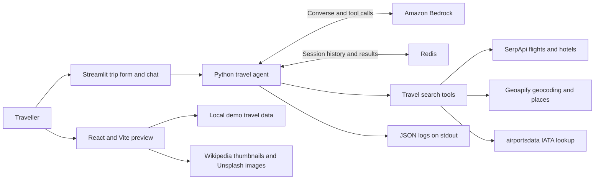

# TravelBuddy

TravelBuddy is a travel planner for trips within India. The Python and
Streamlit app searches for flights, hotels, restaurants, and attractions, then
uses Amazon Bedrock to draft an itinerary and explain a Python-calculated
budget. The React and Vite app is a separate UI preview with sample results.
Live planning currently runs through Streamlit.

## Architecture



## Agent workflow

1. The traveller enters a route, travel dates, trip type, traveller count,
   and optional budget in Streamlit, or types a request in chat.
2. The agent loads session history from Redis and sends the request and
   available tool schemas to Bedrock Converse. Bedrock selects tools. Python
   dispatches only flight, hotel, restaurant, and attraction searches.
3. The tools resolve airport codes and destinations, normalize provider
   results, and rank flights by fare and hotels by total stay price.
   Round-trip searches list up to five outbound choices and five compatible
   returns per outbound. Separate one-way searches are a fallback.
4. Python calculates an indicative subtotal from usable flight and hotel
   fares and estimated daily expenses. The subtotal identifies missing costs.
5. Bedrock drafts the itinerary from the search results. Python appends the
   round-trip flight lists and search notices. A failed search can leave other
   results usable, and a Bedrock timeout can return a partial summary.
6. Redis stores chat messages and structured results per session, with a
   six-hour expiry. Follow-ups receive the chat history and a summary of
   saved search results.

## Integrations

- **Amazon Bedrock Converse via Boto3** handles tool selection and natural
  language responses. The default model is `amazon.nova-lite-v1:0`. Select a
  model available to your AWS identity and region. The identity needs
  `bedrock:InvokeModel`. [AWS Converse documentation](https://docs.aws.amazon.com/bedrock/latest/userguide/conversation-inference.html)
- **SerpApi** supplies Google Flights and Google Hotels search results.
  A round-trip departure token retrieves compatible return choices.
  [Google Flights API](https://serpapi.com/google-flights-api) · [Google Hotels API](https://serpapi.com/google-hotels-api)
- **Geoapify** geocodes the destination and queries its Places API for nearby
  restaurants and attractions. The geocoding result also supplies the
  destination snapshot.
- **Redis** persists chat and search state. The request can continue if Redis
  is unavailable, with reduced continuity across turns.
- **Wikipedia and Unsplash** supply images for the React preview. Flight,
  hotel, and restaurant cards in that preview use local demo data.

## Local setup

### Streamlit live planner

Use Python 3.12 to match CI. Run these PowerShell commands from the repository
root in your Python environment:

```powershell
python -m pip install -r backend/requirements.txt
Copy-Item backend/.env.example backend/.env
```

Fill in the server-side configuration using
[`backend/.env.example`](backend/.env.example). Run the copy command for a new
setup and keep existing credentials in your local `backend/.env`.

- Set `SERPAPI_KEY` and `GEOAPIFY_KEY` to enable live travel searches.
- Set `AWS_REGION` and `BEDROCK_MODEL_ID` for your Bedrock setup. Authenticate
  with an AWS profile, an attached IAM role, or the AWS credential variables
  in the template. Temporary AWS credentials also require `AWS_SESSION_TOKEN`.
- Start Redis locally or set `REDIS_URL` to a reachable instance. The default
  URL is `redis://localhost:6379/0`.
- Set both `BEDROCK_INPUT_USD_PER_MILLION` and
  `BEDROCK_OUTPUT_USD_PER_MILLION` to enable cost estimates in JSON logs.

Keep real credentials out of Git and out of Vite variables. Start Streamlit
from the repository root and open the URL printed in the terminal:

```powershell
python -m streamlit run backend/main.py
```

### React preview

With Node.js and npm installed, run the following from the repository root:

```powershell
cd frontend
npm ci
npm run dev
```

## Deployment

- **Streamlit.** Install `backend/requirements.txt` on a Python host, inject
  credentials through its secret configuration, and connect to Redis. Run
  `python -m streamlit run backend/main.py --server.headless=true --server.address=0.0.0.0 --server.port=8501`
  from the repository root. For a public deployment, put the service behind
  a TLS reverse proxy that supports WebSockets and apply access controls to
  limit use of paid services. [Streamlit deployment guidance](https://docs.streamlit.io/knowledge-base/deploy/deploy-streamlit-domain-port-80)
- **React preview.** Run `npm ci` and `npm run build` in `frontend/`, then publish
  `frontend/dist/` to a static host. The preview stays in demo mode.
  `VITE_API_BASE_URL` configures a future `/api/chat` integration. This
  repository currently has no server for that endpoint.

## Sample requests and expected output

- **New trip.** “Plan a round trip from Hyderabad to Goa for 2 adults,
  departing 2027-04-10 and returning 2027-04-13. My budget is ₹30,000.”
  Expected output includes the route and dates, ranked outbound and return
  choices when available, hotels, places to visit, a day-by-day itinerary,
  and an estimated budget. Use future dates for live searches.
- **Follow-up in the same session.** “Can you suggest a cheaper hotel for
  those dates?” The answer should address the current trip and report any
  missing hotel prices or unavailable search results.
- **Hotel provider unavailable.** Available flight and destination results
  can still appear, accompanied by “Hotel information is temporarily
  unavailable.” The budget labels the known costs as a subtotal.

Provider results and model wording vary by request.

## Testing and development

```powershell
python -m pip install -r testing/requirements.txt
python -m pytest -c testing/pytest.ini
```

The tests mock SerpApi, Geoapify, Bedrock, and Redis. They use no provider
credentials or paid API calls. The
[GitHub Actions workflow](.github/workflows/backend-tests.yml) runs pytest
on pushes and pull requests. Keep each change and its tests in a focused
commit. Use descriptive subjects such as `Sort round-trip flights by fare`
or `Document Streamlit deployment`.

The backend emits JSON logs for tool calls, API attempts, and request
summaries, including timing, failures, and reported Bedrock usage.
See the [telemetry guide](backend/README.md#request-telemetry) for cost
configuration and log aggregation.

## Known limitations

- The planner targets trips within India. Free-text clarification and
  itinerary timing rely on Bedrock. Python does basic validation and does
  not independently verify that every activity fits the flight schedule.
- Flight availability and prices can change. The provider may return fewer
  than five choices per leg. Complete the booking with the provider.
- Food, local transport, and miscellaneous costs are estimates. Missing
  fares or hotel prices can prevent a full budget comparison.
- Follow-ups receive the conversation and a summary of saved results. Exact
  option details may depend on what the previous answer included.
- The React preview uses demo travel data. My Trips is a placeholder.

## Implementation and attribution

Project-specific code includes the Streamlit trip form, Python Bedrock tool
loop, provider adapters, flight and hotel ranking, budget calculation,
Redis session logic, telemetry, React components, and mocked tests.

The project uses Streamlit, React, Vite, Boto3/Botocore, Requests,
python-dotenv, airportsdata, redis-py, pytest, and GitHub Actions. The
React preview uses a React/Vite starter structure. The provider APIs and
frontend image sources are listed under [Integrations](#integrations).
Codex assisted with code changes, testing, and documentation in this
workspace. Earlier examples, template sources, and other AI assistant
usage are unverified.
