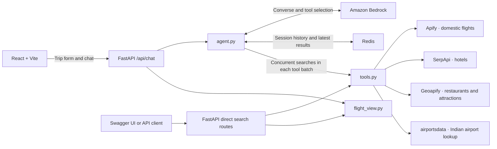

# TravelBuddy

TravelBuddy is a travel planner for trips within India. The Python agent
searches for flights, hotels, restaurants, and attractions, then
uses Amazon Bedrock to draft an itinerary and explain a Python-calculated
budget. The React and Vite app sends trip requests and follow-ups to FastAPI
and displays live search results in the Flights, Hotels, Restaurants, and
Places to Visit tabs. Place cards link to Maps and let travellers ask the
assistant about a specific attraction.

## Architecture

The React app in `frontend/` sends the trip form and chat messages to
`POST /api/chat`. FastAPI in `backend/` also exposes direct flight, hotel,
and restaurant endpoints for testing or use by other clients.



- `backend/main.py` validates requests, loads backend configuration, and
  serves the API.
- `backend/agent.py` coordinates Bedrock, travel searches, and budget estimates.
  `backend/prompt.py` defines the agent's instructions.
- `backend/tools.py` calls the providers and normalizes their results.
  `backend/flight_view.py` formats flight results for the API and Flights tab.
- `backend/memory.py` stores session history and results in Redis.
  `backend/log.py` records request and provider events.
- `frontend/src/services/chatService.js` sends requests to FastAPI.
  `frontend/src/App.jsx` manages trip and chat state, and
  `frontend/src/components/ResultsPanel.jsx` renders the result tabs.

## Agent workflow

1. A Python caller passes a travel request and a session ID to
   `TravelAgent.chat`. A request can include the route, dates, trip type,
   traveller count, and budget.
2. The agent loads session history from Redis and sends the request and
   available tool schemas to Bedrock Converse. Bedrock selects tools. Python
   runs independent searches in the same Bedrock tool batch concurrently on
   up to four worker threads. Each provider call uses synchronous HTTP.
   A later tool batch starts after the current batch finishes.
3. The tools resolve airport codes and destinations, normalize provider
   results, and rank flights by fare and hotels by total stay price.
   For a round trip, the flight tool runs the outbound search first and the
   return search second. Each leg has its own fare and up to five options.
   A standalone one-way search returns up to six options.
4. Python calculates an indicative subtotal from usable flight and hotel
   fares and estimated daily expenses. The subtotal identifies missing costs.
5. Bedrock drafts the itinerary from the search results. Python appends the
   round-trip flight lists and search notices. A failed search can leave other
   results usable, and a Bedrock timeout can return a partial summary.
6. Redis stores chat messages and structured results per session, with a
   six-hour expiry. Follow-ups receive the chat history and a summary of
   saved search results.

## Integrations

- **Amazon Bedrock Converse via Boto3** handles tool selection and natural
  language responses. The default model is `amazon.nova-lite-v1:0`. Select a
  model available to your AWS identity and region. The identity needs
  `bedrock:InvokeModel`. [AWS Converse documentation](https://docs.aws.amazon.com/bedrock/latest/userguide/conversation-inference.html)
- **Apify** supplies domestic Indian flight options and indicative fares through the
  [Google Flights Scraper actor](https://apify.com/famed_bonobo/google-flights-scraper).
  Actor runs use your Apify usage credits.
- **SerpApi** supplies Google Hotels search results.
  [Google Hotels API](https://serpapi.com/google-hotels-api)
- **Geoapify** geocodes the destination and queries its Places API for nearby
  restaurants and attractions. The geocoding result also supplies the
  destination snapshot.
- **Redis** persists chat and search state. The request can continue if Redis
  is unavailable, with reduced continuity across turns.
- **Wikipedia and Unsplash** supply destination images for the React app.

## Local setup

### Terminal 1 · Python backend

Use Python 3.12 to match CI. Run these PowerShell commands from the repository
root in your Python environment:

```powershell
python -m pip install -r backend/requirements.txt
if (-not (Test-Path backend/.env)) { Copy-Item backend/.env.example backend/.env }
```

Fill in the server-side configuration using
[`backend/.env.example`](backend/.env.example). Run the copy command for a new
setup and keep existing credentials in your local `backend/.env`.

- Set `APIFY_TOKEN` for Indian domestic flights, `SERPAPI_KEY` for hotels,
  and `GEOAPIFY_KEY` for attractions and restaurants.
  Create an Apify personal API token in **Settings → API & Integrations**.
  Restart the backend after updating `backend/.env`.
- Set `AWS_REGION` and `BEDROCK_MODEL_ID` for your Bedrock setup. Authenticate
  with an AWS profile, an attached IAM role, or the AWS credential variables
  in the template. Temporary AWS credentials also require `AWS_SESSION_TOKEN`.
- Start Redis locally or set `REDIS_URL` to a reachable instance. The default
  URL is `redis://localhost:6379/0`.
- Set both `BEDROCK_INPUT_USD_PER_MILLION` and
  `BEDROCK_OUTPUT_USD_PER_MILLION` to enable cost estimates in JSON logs.

Keep real credentials out of Git and out of Vite variables. The API loads
`backend/.env` without overriding existing process environment variables.
Use a local Redis URL when running outside Render's private network.

Start the API from the repository root:

```powershell
python -m uvicorn main:app --app-dir backend --host 127.0.0.1 --port 8000 --reload
```

Open [Swagger UI](http://127.0.0.1:8000/docs) to try the API.

### Terminal 2 · React frontend

With Node.js and npm installed, run the following from the repository root:

```powershell
Set-Location frontend
npm ci
npm run dev
```

Open the local URL printed by Vite, usually `http://localhost:5173/`.
Start the backend in a separate terminal. The frontend defaults to
`http://localhost:8000`. Set `VITE_API_BASE_URL` to your API origin before
starting or building Vite if you use a different address.

## API endpoints

- `GET /health` checks the HTTP process without contacting providers.
- `GET /api/cities` lists Indian airport cities for the trip form.
- `POST /api/chat` accepts `message`, `session_id`, and optional `trip`.
  Use a unique session ID per conversation. A trip accepts `source`,
  `destination`, `trip_type` (`round` or `oneway`), `travellers`,
  `start_date`, optional `budget`, and `end_date` for round trips.
  The response includes `answer`, `results`, `notices`, `budget`, and
  `outcome`. Results contain the searches performed in the current request.
  A missing category means it was not searched. A null result means its
  search failed and no result was available.
- `POST /api/flights` accepts the same fields as `trip` in the chat request.
  Try Delhi (`DEL`) to Mumbai (`BOM`) with a future travel date.
  Apify prices the outbound and return separately. Each fare covers all travellers.
  Flight results from both endpoints use separate `outbound` and `return`
  sections. Both sections use `fare_type: one_way`; for a one-way trip,
  `return` is null. Each option includes a fare and flight segments with the
  carrier, flight number, and timings when available. Check `warnings` when a
  round-trip leg is empty.
- `POST /api/hotels` accepts `destination`, `check_in_date`, `check_out_date`,
  and optional `travellers` and `rooms`.
- `POST /api/restaurants` accepts `destination` and optional `radius_meters`
  and `limit`.

The individual searches call travel providers directly without invoking
Bedrock. Flights include `airline_website` for mapped carriers such as
IndiGo. For itineraries with multiple carriers, use the website on each
segment. Hotels include `property_website` when the provider supplies a
property link. Use `search_link` when a website is missing. These website
links open the airline or property site for the traveller to book there.
Restaurants include a Maps link and a website when available.

In Swagger UI, open **POST /api/flights → Try it out** and submit this example
with future travel dates. Check the **Response body** for
`outbound.options` and `return.options`.

```json
{
  "source": "Hyderabad",
  "destination": "Tirupati",
  "trip_type": "round",
  "travellers": 1,
  "start_date": "2027-04-10",
  "end_date": "2027-04-13"
}
```

## Deployment

- **Python backend.** With the repository root as the Render service root,
  install `backend/requirements.txt` and start with
  `python -m uvicorn main:app --app-dir backend --host 0.0.0.0 --port "$PORT"`.
  In the Render backend service's **Environment** page, set `APIFY_TOKEN` for
  flights, `SERPAPI_KEY` for hotels, `GEOAPIFY_KEY` for places, `REDIS_URL`,
  and `CORS_ORIGINS`. Deploy a revision that contains the Apify integration.
  Open `/docs` on that deployed backend and try `POST /api/flights` with
  `source` set to `DEL`, `destination` set to `BOM`, `trip_type` set to
  `oneway`, `travellers` set to `1`, and a future `start_date`.
  A successful search lists fares under `outbound.options`. The chat endpoint needs access
  controls and rate limiting before public use with paid providers.
- **React app.** Set `VITE_API_BASE_URL` to the deployed API origin, run
  `npm ci` and `npm run build` in `frontend/`, then publish `frontend/dist/`
  to a static host. Include the frontend origin in the backend's `CORS_ORIGINS`.

## Sample requests and expected output

- **New trip.** “Plan a round trip from Hyderabad to Goa for 2 adults,
  departing 2027-04-10 and returning 2027-04-13. My budget is ₹30,000.”
  Expected output includes the route and dates, ranked outbound and return
  choices when available, hotels, places to visit, a day-by-day itinerary,
  and an estimated budget. Use future dates for live searches.
- **Follow-up in the same session.** “Can you suggest a cheaper hotel for
  those dates?” The answer should address the current trip and report any
  missing hotel prices or unavailable search results.
- **Hotel provider unavailable.** Available flight and destination results
  can still appear, accompanied by “Hotel information is temporarily
  unavailable.” The budget labels the known costs as a subtotal.

Provider results and model wording vary by request.

## Testing and development

```powershell
python -m pip install -r testing/requirements.txt
python -m pytest -c testing/pytest.ini
```

The tests mock Apify, SerpApi, Geoapify, Bedrock, and Redis. They use no provider
credentials or paid API calls. The
[GitHub Actions workflow](.github/workflows/backend-tests.yml) runs pytest
on pushes and pull requests. Keep each change and its tests in a focused
commit. Use descriptive subjects such as `Sort round-trip flights by fare`
or `Document backend configuration`.

The validation tests capture current behavior. The backend rejects a missing
round-trip return date, can pass malformed departure dates to the provider
for rejection, and clamps non-positive traveller counts to one.

## Request telemetry

The backend writes one JSON record per event to stdout. Use the generated
`request_id` to correlate provider attempts, tool calls, and the request summary.
The summary records wall-clock duration, Bedrock attempts (including retries),
reported tokens, and operation counts and failure rates by service. Empty
searches have their own outcome. Redis events time each memory operation,
which can include multiple Redis commands.

The cost estimate covers reported input and output tokens at the configured
rates. `llm_usage_responses` counts attempts that reported usage. The estimate
excludes attempts without usage, provider fees, and separate cache pricing.

For production trends, collect stdout and aggregate `request_completed` by
outcome and `api_call` by service and error code. Calculate failure rates as
failed calls divided by total calls over the same time window. Application
events omit prompts, answers, session IDs, tool arguments, provider URLs,
credentials, and raw exception messages.

## Known limitations

- The planner targets trips within India. Free-text clarification and
  itinerary timing rely on Bedrock. Python does basic validation and does
  not independently verify that every activity fits the flight schedule.
- Flight availability and prices can change. The provider may return fewer
  than five choices per leg. Complete the booking with the provider.
- If city lookup fails, enter the three-letter IATA airport code. Check
  restaurant opening hours with the venue before visiting.
- Food, local transport, and miscellaneous costs are estimates. Missing
  fares or hotel prices can prevent a full budget comparison.
- Follow-ups receive the conversation and a summary of saved results. Exact
  option details may depend on what the previous answer included.
- My Trips is a placeholder.

## Implementation and attribution

Project-specific code includes the Python Bedrock tool
loop, provider adapters, flight and hotel ranking, budget calculation,
Redis session logic, telemetry, React components, and mocked tests.

The project uses React, Vite, Boto3/Botocore, Requests,
airportsdata, redis-py, pytest, and GitHub Actions. The
React app uses a React/Vite starter structure. The provider APIs and
frontend image sources are listed under [Integrations](#integrations).
Codex assisted with code changes, testing, and documentation in this
workspace. Earlier examples, template sources, and other AI assistant
usage are unverified.
